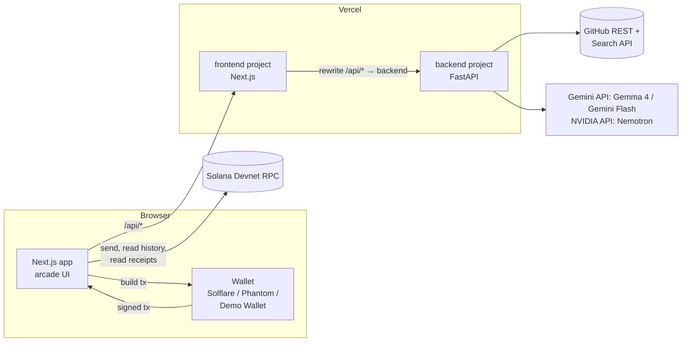

# BountyBridge

**An open-weight AI finds the open-source issue that fits you, GitHub proves your PR was merged, and Solana pays the bounty and keeps the score.**

Built in one day at **Hacktoberfest Hack Day College Park × GDSC UMD** (October 25, 2026) for the **Best Open-Source AI Project** and **Best Use of Solana** prize categories.

| | |
|---|---|
| **Live app** | https://frontend-nine-zeta-orqexn6sj7.vercel.app |
| **Live API** | https://backend-eight-smoky-28.vercel.app/api/health · interactive docs at [`/docs`](https://backend-eight-smoky-28.vercel.app/docs) |
| **Example on-chain payout** | [Devnet transaction `2QzZ2awi…`](https://explorer.solana.com/tx/2QzZ2awizs3x6RWjaERGqSCzGbiaF3JDmr8Kbnz6NyELwCRzQLAKLmnShfS6nxW474DebPMPA5hKD3i21FVyRq18?cluster=devnet): 0.05 SOL + bounty memo in one transaction |
| **Example contributor profile** | [`/?wallet=KzuZ…EnD`](https://frontend-nine-zeta-orqexn6sj7.vercel.app/?wallet=KzuZyiJ83MGnHE9DFhtDZKgaca7bWmC2G1zinhw4EnD#high-scores) |
| **Demo script** | [DEMO.md](DEMO.md) |
| **Submission write-up** | [SUBMISSION.md](SUBMISSION.md) |
| **License** | [MIT](LICENSE) |

---

## Contents

- [The problem](#the-problem)
- [What it does: the four levels](#what-it-does-the-four-levels)
- [Built, not deployed yet](#built-not-deployed-yet)
- [Tech stack](#tech-stack)
- [The trust model](#the-trust-model)
- [Architecture](#architecture)
- [AI pipeline in detail](#ai-pipeline-in-detail)
- [GitHub integration in detail](#github-integration-in-detail)
- [Solana integration in detail](#solana-integration-in-detail)
- [API reference](#api-reference)
- [Frontend](#frontend)
- [Project structure](#project-structure)
- [Configuration](#configuration)
- [Running locally](#running-locally)
- [Testing](#testing)
- [Deployment](#deployment)
- [Measured performance](#measured-performance)
- [Security and limitations](#security-and-limitations)
- [Troubleshooting](#troubleshooting)
- [Roadmap](#roadmap)

---

## The problem

- **Contributors:** a first-timer's hardest moment in Hacktoberfest is the first half hour. Which repo? Which issue is actually doable with my skills and time?
- **Maintainers:** there's no lightweight way to reward the people who show up, and no portable, verifiable record of who contributed what.

BountyBridge closes that loop. The AI does the matching, and the AI never touches money or decides what is true.

---

## What it does: the four levels

The UI is a retro arcade game in four "levels". Each level stays locked until the one above it is cleared.

### Level 1: Choose your repo
- Type a repo as `owner/name` or a full GitHub URL, or click **★ Find repos for me**.
- **Find repos for me** runs one GitHub search for **active `hacktoberfest` repos in your languages with at least 3 open good first issues**, pushed in the last 30 days, with 50–20,000 stars. You get up to 6 clickable picks with stars, language and description.
- **Owner search:** type an owner in the repo box (`microsoft`, `microsoft/`, or `microsoft/auto`) and the button becomes **★ Find microsoft repos**. It searches that owner's repos (orgs included), optionally filtered by name. The Hacktoberfest-topic and star filters are dropped here, because big orgs rarely tag repos.
- **Your profile:** languages, **experience** (Beginner / Intermediate / Advanced) and **hours available** (1–20 slider).
- **Experience changes which issues are fetched**, not just how they're ranked:

  | Experience | Issue labels fetched by default |
  |---|---|
  | Beginner | `good first issue` |
  | Intermediate | `help wanted` |
  | Advanced | *(none: any open issue)* |

  If you've typed your own labels, switching levels keeps yours. If a repo has no issues with the chosen labels, the backend falls back to all open issues and the UI says so.

#### Supported languages
The languages field is free text: enter any GitHub language name, **1–5 at a time, comma-separated** (for example `python, typescript`). Case doesn't matter, and duplicates are removed. On October 25, 2026, **Find repos for me** was checked live with each of these, and every one returned active Hacktoberfest repos:

> Python · JavaScript · TypeScript · Go · Rust · Java · C++ · C# · Ruby · PHP · Kotlin · Swift

Less common languages (Scala, Dart, Elixir, Haskell, Lua and so on) also work; they just return fewer repos. Results are cached for 15 minutes. GitHub search allows about 10 requests a minute without a token and 30 with one, so if you see *"rate limit hit"*, wait a minute (the production backend has a token set).

### Level 2: Pick a quest
- While the model works, an arcade **LOADING LEVEL** screen shows an animated pixel bar and rotating tips that explain how the system works.
- You get **3 quests**. Each card shows:
  - the issue number and title (linked to GitHub),
  - a **✓ verified on GitHub** badge,
  - a 10-segment **FIT** bar with a 0–100 score,
  - the model's rationale, plus a collapsible **game plan** (numbered steps and files to look at).
- A summary line shows **which model answered** (`gemma`, `gemini` or `nvidia`), **which attempt passed validation** (with a note if a first answer cited a non-existent issue and was rejected), and **which labels were used**.
- **Accept quest** selects one. **✕ Drop quest** deselects it and relocks Level 3. Accepting is local UI state only; nothing is saved or sent until Pay.

### Level 3: Approve & pay bounty (maintainer)
1. **Contributor wallet:** a Devnet Solana address.
2. **Merged PR link** → **Verify.** The backend asks GitHub whether the PR exists, belongs to this repo and is merged. The panel shows **GITHUB CHECK: PASSED / FAILED** with:
   - ✓/✗ the PR is in the repo,
   - ✓/✗ merged, with the date,
   - ✓ or ~ whether the PR mentions the issue number,
   - the PR title and author.

   Editing the link invalidates the check.
3. **Bounty (SOL)**, 0.05 by default.
4. Tick **"I'm the maintainer. I reviewed this PR and approve paying this bounty."**
5. The **on-chain memo preview** shows exactly what will be recorded.
6. **🪙 Pay** is enabled only when the wallet is connected, the address is valid, the GitHub check passed, the amount is valid, the memo fits, and the box is ticked. Any unmet condition is listed in red.
7. Before sending, the app checks the contributor's recent history and **blocks a second payout for the same `repo#issue`** to the same contributor, with a link to the earlier payout.
8. On success: **QUEST COMPLETE!**, an Explorer link, and an **on-chain receipt**. The app reads the transaction back from Devnet and checks: transaction succeeded · exact SOL received by the contributor · bounty memo in the same transaction · signed by the maintainer's wallet.

### Level 4: High scores (on-chain)
- Enter any wallet → **Load scores** reads its BountyBridge payouts straight from the chain. There is no database.
- Shows **QUESTS CLEARED: N** and one row per payout: `repo#issue`, PR link, transaction link and date.
- **🔗 Share profile** copies `…/?wallet=<address>#high-scores`. Opening that link scrolls to High Scores and loads that wallet automatically: a shareable, verifiable open-source résumé.

---

## Built, not deployed yet

> These features are **written but not yet committed or deployed**, so they aren't on the live site. They'll appear after the next push to `main`.

### Quest count slider
- A **"Quests to find"** slider (3–9, default 3) under *Hours available*.
- The backend's `RecommendRequest` takes `count` (3–9, default 3) and fetches `max(10, 2 × count)` issues, so the model has room to choose. If the model returns more than `count`, the backend keeps the best `count` by `fit_score`.
- Until this ships, the live app always returns **3** recommendations.

### Contributor tools

- Save up to 20 quests in this browser and resume an accepted quest after refresh. Saved recommendations are marked historical; wallet approval and payment details are never restored.
- Track contribution steps with a persistent checklist, scoped to the repository, issue and exact step text.
- Watch elapsed time while recommendations load. The arcade scan is indeterminate, not a claimed completion percentage.
- Open a starter guide with real README/contribution documents and verified file links pinned to the retrieved commit.
- Copy or share a Devnet reward receipt after on-chain verification. It includes the issue, PR, amount, payer, recipient and Explorer link; clipboard failures fall back to selectable text.

Recommendations now use a five-minute-cached GitHub snapshot: up to 800 file paths (32,000 path characters), three document excerpts and two relevant code excerpts. Retrieval has a 12-second budget. Model-suggested paths are filtered against the snapshot. Missing context falls back explicitly to issue descriptions; partial snapshots are labeled. Repository content is reference data, not model instructions.

Browser storage is local to this device and origin; clearing it removes saved quests and checklists. If storage is blocked, the app warns and keeps changes in memory for the current session.

---

## The trust model

> **The AI suggests. GitHub verifies. A human approves. The wallet signs.**

| Decision | Who makes it | Enforced by |
|---|---|---|
| Which issues exist | **GitHub** | Backend fetches issues; model output is cross-checked against them |
| Which issue fits you | **AI** (advisory only) | Pydantic schema + issue-number check + 1 retry |
| Was the PR merged into this repo? | **GitHub** | `POST /api/verify-pr`; Pay is locked until it passes |
| Should this bounty be paid? | **The maintainer** | Approval checkbox in the UI |
| Moving SOL | **The maintainer's wallet** | The wallet signs in the browser; **no private keys on any server** |
| Proof of payment and contribution record | **Solana** | Transfer + memo in one atomic transaction, read back as a receipt |

---

## Tech stack

| Layer | Tech | What it does here |
|---|---|---|
| Frontend | Next.js 16.3, React 19.2, TypeScript 5 | Single-page arcade UI (Levels 1–4); the browser calls same-origin `/api/*`, which Next forwards to the backend |
| Styling | Tailwind CSS 4, Press Start 2P + VT323 fonts | Pixel/arcade theme, always dark, UMD red/gold palette |
| Wallet & chain | `@solana/kit` 7, `@solana/react` 7, `@solana/kit-plugin-wallet` (Wallet Standard), `@solana-program/system` + `@solana-program/memo` | Connect Solflare/Phantom/Demo Wallet; sign one transaction with the SOL transfer + bounty memo; live balance; on-chain receipt read-back |
| Network | Solana **Devnet** only | Mainnet is locked out in the UI |
| Backend | Python 3.13, FastAPI, Uvicorn | `/api/health`, `/api/discover`, `/api/recommend`, `/api/verify-pr` |
| Validation | Pydantic 2 | Validates model JSON; rejects issue numbers GitHub didn't return; retries once |
| GitHub | httpx + GitHub REST & Search APIs | Issues (5 min cache), repo discovery (15 min cache), PR-merged check |
| AI | Gemma 4 26B A4B (open-weight, Gemini API) → Gemini 3.5 Flash → NVIDIA Nemotron 3.5 Lightning (open-weight) → Groq (optional) | One OpenAI-compatible interface with automatic fallback (`PROVIDER_ORDER`) |
| Tests | pytest (backend); Vitest + Testing Library + Surfpool local chain (frontend) | The payout flow is tested end to end on an offline chain |
| Tooling | ESLint 9, Prettier 3 | `npm run ci` runs build, typecheck, lint, format check and tests |
| Hosting | Vercel, **two projects** | `frontend` (Next.js, root `frontend/`) and `backend` (FastAPI, root `backend/`), both deployed from `main`. The frontend's `next.config.ts` forwards `/api/*` to the backend URL (`BACKEND_URL`) |

---

## Architecture



- The browser **only ever calls its own origin** (`/api/*`). The Next.js frontend forwards those calls to the FastAPI backend (`next.config.ts` rewrites), so there's **no CORS setup** in production.
- **All Solana traffic is browser → Devnet RPC** (`https://api.devnet.solana.com`). The backend never touches the chain or any key.
- **The backend is stateless** apart from small in-memory caches.

### Request flow: one recommendation
1. `POST /api/recommend {repo, profile, labels}`
2. `parse_repo()` normalizes `owner/name` or a GitHub URL.
3. GitHub: `GET /repos/{repo}/issues?state=open&labels=…&per_page=10`, with pull requests filtered out and bodies trimmed to 1,500 chars. Results are cached for 5 min. With no labeled issues, it refetches without labels.
4. Prompt = system rules + developer profile + up to 10 issues (each body capped at 400 chars).
5. The model (Gemma → Gemini → Nemotron fallback) returns JSON.
6. `json.loads` → `normalize_output` → Pydantic `ModelOutput` → `check_against_issues` (every `issue_number` must be one GitHub returned).
7. On any failure, the error is fed back and the model retries once (`MAX_ATTEMPTS = 2`). Then 3 recommendations are returned, sorted by fit and joined with the real GitHub issue data.

---

## AI pipeline in detail

### Providers (`backend/agent/provider.py`)

All providers use **one OpenAI-compatible `/chat/completions` client** (`OpenAICompatibleProvider`) with `temperature: 0.2`, `response_format: {"type": "json_object"}`, and a **30 s timeout per provider**. `FallbackProvider` tries them in order and reports which one answered.

| Order | Name | Model (default) | Open-weight | Endpoint | Key | Thinking setting | Typical latency* |
|---|---|---|---|---|---|---|---|
| 1 | `gemma` | `gemma-4-26b-a4b-it` | **Yes** | Gemini API (OpenAI-compatible) | `GEMINI_API_KEY` | `reasoning_effort: "minimal"` (the lowest it accepts) | ~12–15 s |
| 2 | `gemini` | `gemini-3.5-flash` | No | Gemini API | `GEMINI_API_KEY` | `reasoning_effort: "none"` | ~4–7 s |
| 3 | `nvidia` | `nvidia/nemotron-3.5-lightning-30b-a3b` | **Yes** | `integrate.api.nvidia.com/v1` | `NVIDIA_API_KEY` | `chat_template_kwargs.enable_thinking: false` | ~6–10 s |
| 4 | `groq` | `qwen/qwen3.8-27b` | Yes | `api.groq.com/openai/v1` | `GROQ_API_KEY` | default | not benchmarked |

\* For the full recommendation prompt (10 issues). See [Measured performance](#measured-performance).

- `PROVIDER_ORDER` (default `gemma,gemini,nvidia,groq`) reorders them. Providers without a key are skipped, and an unknown name is a startup error.
- `GEMMA_MODEL`, `GEMINI_MODEL`, `NVIDIA_MODEL` and `GROQ_MODEL` override the model ids.
- **Why thinking is off or minimal:** with default reasoning, Nemotron took ~40 s and Gemma ~77 s, and Gemma returned broken JSON. Turning reasoning down gave the same valid output in seconds. Correctness is enforced by validation, not by the model's reasoning.
- **Fallback in practice:** during testing, Gemini returned HTTP 503 "high demand" twice, and requests completed on the next provider with no visible error.

### Prompt (`backend/agent/orchestrator.py`)
The system prompt requires JSON only, in this shape:
```json
{"recommendations": [{"issue_number": 0, "fit_score": 0, "rationale": "",
  "steps": [""], "files_to_look_at": [""]}]}
```
Its other rules:
- **exactly 3** different recommendations, best first (3–9 once the [quest count slider](#quest-count-slider) ships),
- use the full 0–100 range for `fit_score`,
- **match difficulty to experience and hours**:
  - beginner → small, well-scoped work (docs, tests, typing, a contained bug), never architecture,
  - intermediate → a real feature or non-trivial bug touching a few files,
  - advanced → the hardest, most impactful issues, never a trivial docs or typo fix,
- the score reflects fit for *this* developer, and the rationale must say why the difficulty fits.

### Validation and repair
| Check | What happens on failure |
|---|---|
| Valid JSON | Retry with the parse error |
| `normalize_output`: accepts `[{"recommendations": [...]}]` or a bare list of recommendations (Gemma sometimes wraps the object) | Repaired in place, so no retry is wasted |
| Pydantic `ModelOutput`: 1–3 items; `fit_score` 0–100; non-empty `rationale` and `steps`; no duplicate issue numbers | Retry with the validation error |
| `check_against_issues`: every `issue_number` must be in the fetched list | Retry with *"issue numbers [...] do not exist; choose from [...]"* |
| Still invalid after 2 attempts | HTTP 502 with the last error; nothing is shown as a recommendation |

`backend/scripts/smoke_model.py` sends one tiny JSON task to every configured provider and prints the latency and validity (never the keys).

---

## GitHub integration in detail

`backend/services/github_service.py` uses one `httpx.Client` (15 s timeout). It sends `Authorization: Bearer $GITHUB_TOKEN` when the token is set.

| Operation | GitHub endpoint | Cache | Notes |
|---|---|---|---|
| List issues | `GET /repos/{repo}/issues?state=open&labels=…&per_page=10` | **5 min** per (repo, labels) | Removes PRs (the issues API returns both) and trims bodies to 1,500 chars |
| Discover repos | `GET /search/repositories?q=…&sort=stars&per_page=6` | **15 min** per (languages, owner, name) | 403/429 → clear "rate limit, set GITHUB_TOKEN" error |
| Verify PR | `GET /repos/{repo}/pulls/{n}` | none | A PR from another repo is rejected **without calling GitHub**; 404 → "PR not found" |

**Discovery query** (repeated `language:` qualifiers are OR'd by GitHub):
```text
# default
topic:hacktoberfest stars:50..20000 good-first-issues:>=3 archived:false pushed:>=<30 days ago> language:"python" ...
# with an owner typed in the repo box
user:<owner> [<name> in:name] good-first-issues:>=3 archived:false pushed:>=<30 days ago> language:"python" ...
```
User input is validated before it reaches the query. Languages must match `^[\w#+.\- ]{1,30}$` (up to 5). Owners follow GitHub's naming rules, and name fragments must match `^[\w.-]{1,100}$`. So nobody can inject extra search qualifiers.

**PR verification** returns `ok = merged && repo_matches`, plus:
- `mentions_issue` (informational): the title or body contains `#<issue>` or `/issues/<issue>`,
- `title`, `author`, `merged_at`.

**Rate limits:** without a token, GitHub allows 60 core requests per hour and 10 searches per minute. With `GITHUB_TOKEN`: 5,000 per hour and 30 searches per minute. The production backend has a token set.

---

## Solana integration in detail

- **Network:** Devnet only. The network menu offers only `devnet` (`CLUSTERS = ["devnet"]`), and a previously stored `mainnet` choice falls back to devnet. RPC: `https://api.devnet.solana.com`, websocket `wss://api.devnet.solana.com`.
- **Client:** `@solana/kit` 7 plugin client (`createClient().use(walletSigner).use(solanaRpc).use(systemProgram).use(memoProgram)…`) with a 1,000 micro-lamport per compute unit priority fee.
- **Wallets:** anything that implements the **Wallet Standard**: Solflare, Phantom, Backpack, and the built-in Demo Wallet.

### The payout transaction
One transaction built by `client.sendTransaction([transferIx, memoIx])`:

| # | Program | Instruction |
|---|---|---|
| 1–2 | Compute Budget | limit + price (added automatically) |
| 3 | System Program | `transferSol` maintainer → contributor (default 0.05 SOL) |
| 4 | SPL Memo | `bountybridge:v1\|<owner/repo>#<issue>\|<PR URL>`, signed by the maintainer |

Both instructions are in one transaction, so they succeed or fail together: **there is never a payment without its record, or a record without its payment.** The library sends and waits for `confirmed` commitment before the UI reports success.

**Memo format** (`frontend/app/lib/memo.ts`):
```text
bountybridge:v1|collective/icalendar#1868|https://github.com/collective/icalendar/pull/1989
```
- The memo is capped at 509 UTF-8 bytes (the single-signer packet limit), and the UI blocks longer ones.
- Parsing handles the RPC's `"[len] text"` prefix and multiple memos joined with `"; "`.
- The PR link must match `https://github.com/<owner>/<repo>/pull/<n>`.

### Duplicate-payout block
Before sending, `getSignaturesForAddress(contributor, {limit: 100})` is scanned for a memo with the same `repo#issue`. If one is found, the payout is refused, with a link to the earlier transaction.

### On-chain receipt (`frontend/app/lib/receipt.ts`)
After confirmation, the app calls `getTransaction` (up to 8 tries, 1.5 s apart, because a fresh transaction can take a moment to appear) and checks four things, independent of what the wallet reported:
1. Transaction succeeded,
2. Exact SOL received by the contributor (from pre/post balances),
3. Bounty memo recorded in the same transaction,
4. Signed by the maintainer's wallet.

### High scores
`getSignaturesForAddress(wallet, {limit: 200})` → keep successful transactions whose memo parses as `bountybridge:v1` → list them. **No database.**

### Demo Wallet (Devnet)
`frontend/app/lib/demo-wallet.ts` registers **"Demo Wallet (Devnet)"** through the Wallet Standard. It appears in **Connect Wallet** next to any installed extension and signs exactly like one, for locked-down laptops or a judge's machine.
- It advertises only `solana:devnet`.
- A 32-byte key seed is stored in **this browser's** `localStorage` (`bountybridge:demo-wallet-seed`), so the address survives refreshes. Fund it once from [faucet.solana.com](https://faucet.solana.com) or from another Devnet wallet.
- It's a throwaway test key: never send real funds to it.

---

## API reference

Base URL: `https://backend-eight-smoky-28.vercel.app` (or the frontend's own `/api`, which proxies to it). Every route is served under **`/api`**, and also at `/` in case a platform strips the prefix. Interactive OpenAPI docs are at `/docs`.

### `GET /api/health`
```json
{"ok": true}
```

### `POST /api/recommend`
Request:
```json
{
  "repo": "collective/icalendar",
  "profile": {"languages": ["python"], "experience": "beginner", "hours_available": 4},
  "labels": ["good first issue"]
}
```
- `repo`: `owner/name` or a GitHub URL.
- `experience`: `beginner | intermediate | advanced`.
- `hours_available`: 1–80.
- `labels` defaults to `["good first issue"]`; `[]` means any open issue.

Response (abridged):
```json
{
  "repo": "collective/icalendar",
  "provider": "gemma",
  "attempts": 1,
  "labels_used": ["good first issue"],
  "recommendations": [
    {
      "issue": {"number": 1930, "title": "Proper typing for vRecur", "body": "…",
                "labels": ["good first issue"], "url": "https://github.com/collective/icalendar/issues/1930"},
      "fit_score": 95,
      "rationale": "…",
      "steps": ["…"],
      "files_to_look_at": ["src/icalendar/prop.py"]
    }
  ]
}
```
Errors:
- `400`: bad repo format.
- `404`: the repo has no open issues.
- `502`: GitHub error, every model provider failed, or the model output was still invalid after the retry. `detail` explains which.

### `GET /api/discover?languages=python,go[&owner=microsoft][&name=auto]`
```json
{
  "query": "user:microsoft good-first-issues:>=3 archived:false pushed:>=2026-09-25 language:\"python\"",
  "repos": [
    {"full_name": "microsoft/autogen", "description": "…", "language": "Python",
     "stars": 61558, "url": "https://github.com/microsoft/autogen", "pushed_at": "…"}
  ]
}
```
Errors: `400` for an invalid language, owner or name; `502` for a GitHub error or rate limit.

### `POST /api/verify-pr`
```json
{"repo": "collective/icalendar", "issue_number": 1868,
 "pr_url": "https://github.com/collective/icalendar/pull/1989"}
```
```json
{"ok": true, "reason": "Merged PR in this repo", "repo_matches": true, "merged": true,
 "mentions_issue": false, "title": "Use X- names for custom components in test calendars",
 "author": "arrudagba", "merged_at": "2026-…"}
```
Failure reasons:
- `"PR is in other/repo, not owner/repo"`,
- `"PR not found on GitHub"`,
- `"PR is not merged yet"`,
- a badly formed link → `400`.

---

## Frontend

- **Stack:** Next.js 16 (App Router), React 19, Tailwind CSS 4, `@solana/kit` 7, `@solana/react`, `@solana/kit-plugin-wallet`, `sonner` toasts. Scaffolded with `create-solana-dapp` (template `nextjs`).
- **Theme** (`app/globals.css`): retro arcade, always dark.
  - **Press Start 2P** for headings and buttons, **VT323** for body text.
  - CRT scanlines and a perspective pixel-grid floor (`grid-background.tsx`).
  - Square corners and chunky borders with hard shadows (`.pixel-box`, `.pixel-btn`, `.pixel-input`).
  - Palette: **UMD red `#e21833`** for actions, **UMD gold `#ffd200`** for rewards and scores, violet `#9b5cff` and neon `#3dff9a` for Hacktoberfest/Solana accents.
  - Respects `prefers-reduced-motion`, and works at phone width (no sideways scrolling at 375 px).
- **API client** (`app/lib/api.ts`): same-origin `/api` by default (override with `NEXT_PUBLIC_API_URL`).
  - Timeouts: 90 s for `/recommend`, 20 s for `/discover` and `/verify-pr`.
  - **Offline replay:** every successful recommendation is saved in `localStorage`, keyed by repo + languages + experience + hours + labels. If the backend is unreachable or returns a 5xx, the last real result for *that exact request* is shown with an **OFFLINE REPLAY** tag.
- **Dev proxy:** in `next dev`, `/api/*` goes to `http://localhost:8000`. In production it goes to `BACKEND_URL`, defaulting to `https://backend-eight-smoky-28.vercel.app`.

---

## Project structure

```text
UMD_HACKATHON/
├── backend/                      FastAPI service (Vercel project "backend", root dir = backend)
│   ├── main.py                   app, CORS, routes under /api and /
│   ├── agent/
│   │   ├── models.py             Pydantic request/response/model-output schemas
│   │   ├── orchestrator.py       prompt, validation, retry, label fallback
│   │   └── provider.py           Gemma/Gemini/Nemotron/Groq providers + fallback
│   ├── services/
│   │   └── github_service.py     issues, repo discovery, PR verification, caches
│   ├── scripts/smoke_model.py    one tiny JSON task per configured model
│   ├── tests/                    pytest: github service, orchestrator, providers
│   ├── requirements.txt          runtime deps
│   ├── requirements-dev.txt      + pytest
│   └── .python-version           3.13
├── frontend/                     Next.js app (Vercel project "frontend", root dir = frontend)
│   ├── app/
│   │   ├── page.tsx              the four levels
│   │   ├── layout.tsx, globals.css
│   │   ├── components/
│   │   │   ├── bounty/           repo-form, quest-card, loading-screen,
│   │   │   │                     payout-panel, ledger
│   │   │   ├── app-header, wallet-button, cluster-select, cluster-context,
│   │   │   │   providers, grid-background
│   │   └── lib/
│   │       ├── api.ts            backend client + offline replay + repo-scope parser
│   │       ├── memo.ts           bounty memo build/parse, PR link check
│   │       ├── receipt.ts        on-chain receipt checks
│   │       ├── demo-wallet.ts    built-in Wallet Standard Devnet wallet
│   │       ├── solana-client.ts  kit client, Devnet-only cluster list
│   │       └── hooks/            use-send (send + toast), use-balance
│   ├── tests/                    vitest: memo, scope, receipt, payout (local chain), app
│   └── next.config.ts            /api rewrite to the backend
├── DEMO.md                       3-minute demo script, checklist, judge Q&A
├── SUBMISSION.md                 MLH submission write-up
├── vercel.json                   single-project "services" config (not used by the
│                                 current two-project deployment; kept for reference)
├── .vercelignore
└── LICENSE                       MIT
```

---

## Configuration

### Backend environment variables
Locally they go in **`UMD_HACKATHON/.env`** (the project root, gitignored), which is loaded by `main.py`. On Vercel, set them in the **backend** project → Settings → Environment Variables with **Production** ticked, then **redeploy**.

| Variable | Required | Default | Purpose |
|---|---|---|---|
| `GEMINI_API_KEY` | yes* | none | Gemma 4 (primary) and Gemini Flash (backup) |
| `NVIDIA_API_KEY` | recommended | none | Nemotron backup |
| `GROQ_API_KEY` | no | none | optional fourth provider |
| `GITHUB_TOKEN` | recommended | none | GitHub rate limits (60/h → 5,000/h; search 10/min → 30/min) |
| `PROVIDER_ORDER` | no | `gemma,gemini,nvidia,groq` | fallback order |
| `GEMMA_MODEL` / `GEMINI_MODEL` / `NVIDIA_MODEL` / `GROQ_MODEL` | no | see the provider table | override model ids |
| `ALLOWED_ORIGINS` | no | `http://localhost:3000` | CORS list; not needed when the frontend proxies `/api` |

\* At least one model key is required. Without any, `/recommend` returns 502 *"no model API key…"*.

### Frontend environment variables (all optional)
| Variable | Default | Purpose |
|---|---|---|
| `BACKEND_URL` | `https://backend-eight-smoky-28.vercel.app` | where production `/api/*` is forwarded |
| `NEXT_PUBLIC_API_URL` | `/api` | call a different API origin directly from the browser |

---

## Running locally

Requirements: Python 3.13+, Node.js 22+ (the template asks for 24), and git.

```bash
git clone https://github.com/peyton150-startup/UMD_HACKATHON.git
cd UMD_HACKATHON
```

Create `.env` in the project root:
```bash
GEMINI_API_KEY=...
NVIDIA_API_KEY=...
GITHUB_TOKEN=...
```

Backend (http://localhost:8000/docs):
```bash
cd backend
python -m venv .venv
.venv/Scripts/python -m pip install -r requirements-dev.txt   # macOS/Linux: .venv/bin/python
.venv/Scripts/python -m uvicorn main:app --reload
```

Frontend (http://localhost:3000; `/api/*` is proxied to :8000):
```bash
cd frontend
npm install
npm run dev
```

Check that your model keys work:
```bash
cd backend
.venv/Scripts/python scripts/smoke_model.py
```

To try a payout, put your wallet on **Devnet**, fund it from [faucet.solana.com](https://faucet.solana.com) (2 requests per 8 hours; sign in with GitHub for more), or use the built-in **Demo Wallet (Devnet)**.

---

## Testing

| Suite | Command | What it covers |
|---|---|---|
| Backend (24 tests) | `cd backend && .venv/Scripts/python -m pytest` | issue cache expiry; label fallback; repo discovery query building, owner scoping, caching, input validation, rate-limit errors; PR verification (merged / unmerged / other repo / 404 / bad URL); invented-issue retry; give-up after 2 bad replies; list-shaped replies accepted; provider order, key sharing, skipping and fallback |
| Frontend unit | `cd frontend && npx vitest run tests/memo.test.ts tests/scope.test.ts tests/receipt.test.ts` | memo round-trip and RPC prefix parsing; PR link validation; repo-box owner parsing; receipt checks |
| **Payout on a local chain** | see below | the real payout UI + mock wallet against an **offline** Surfpool chain |
| Full frontend CI | `cd frontend && npm run ci` | build, typecheck, lint, Prettier check, tests |

**Payout test** (`frontend/tests/payout.test.tsx`). It never touches Devnet or Mainnet, and checks that:
- Pay stays locked while the PR isn't merged,
- **one transaction** moves exactly 0.05 SOL to the contributor and carries the bounty memo, with the maintainer as fee payer and signer,
- a second payout for the same issue is blocked and the balance is unchanged,
- the high-score ledger lists the payout.

```bash
# terminal 1 (on Windows, Surfpool runs inside WSL)
wsl -d Ubuntu -- bash -lc "surfpool start --offline --no-tui"
# terminal 2
cd frontend
npm run test:chain
```
The suite **skips itself** if nothing is listening on `127.0.0.1:8899`. Override the endpoint with `SURFPOOL_RPC_URL` / `SURFPOOL_WS_URL`. Only `/api/verify-pr` is stubbed; every Solana call goes to the real local chain.

---

## Deployment

Two Vercel projects deploy from this repo's `main` branch, and every push redeploys both.

| Project | Root directory | Framework | Domain | Env vars |
|---|---|---|---|---|
| `backend` | `backend` | FastAPI (Python 3.13) | `backend-eight-smoky-28.vercel.app` | `GEMINI_API_KEY`, `NVIDIA_API_KEY`, `GITHUB_TOKEN` |
| `frontend` | `frontend` | Next.js | `frontend-nine-zeta-orqexn6sj7.vercel.app` | none required (`BACKEND_URL` optional) |

- The frontend forwards `/api/*` to the backend, so the browser stays on one origin and no CORS settings are needed.
- Environment variable changes **only take effect after a redeploy** (Deployments → ⋯ → Redeploy).
- `.vercelignore` keeps `.venv`, `node_modules`, `.next` and caches out of uploads.

---

## Measured performance

Measured live on October 25, 2026, against `collective/icalendar` and other repos:

| Operation | Time |
|---|---|
| `/api/health` | ~0.1–0.4 s |
| Repo discovery (uncached) | ~0.5 s |
| PR verification | < 1 s |
| Recommendation via **Gemma 4** (primary) | **~12–15 s** |
| Recommendation via Gemini 3.5 Flash | ~4–7 s |
| Recommendation via Nemotron 3.5 Lightning | ~6–10 s |
| Payout: wallet signature → confirmed | a few seconds; fee ≈ 0.000005 SOL |

Before turning thinking down: Nemotron ~40 s and Gemma ~77 s with invalid JSON. All Gemma runs since have passed validation on the first attempt.

---

## Security and limitations

**By design**
- No private keys on any server. Every payout is signed in the maintainer's browser wallet.
- The app is locked to Devnet in the UI, and the demo wallet advertises only Devnet.
- Model output is never trusted: schema validation plus cross-checking against GitHub, and nothing the model says unlocks a payment.
- GitHub search input is validated against qualifier injection. Secrets live in `.env` / Vercel env vars, never in the repo (`.env` is gitignored).

**Known limitations (hackathon scope)**
- **No escrow.** The bounty is paid directly by the maintainer at approval time; it isn't locked up front.
- **Whether a PR actually fixes the issue is a human judgment.** The app only flags PRs that don't mention the issue number.
- **Wallet ↔ GitHub identity isn't linked.** The maintainer pastes the contributor's address.
- **The duplicate check** scans the contributor's last 100 transactions, and the **ledger** reads the last 200. It counts transactions with a valid BountyBridge memo, so someone could post a lookalike memo without paying; the on-chain receipt is the stronger proof for each payout.
- **The demo wallet** keeps a throwaway Devnet key in `localStorage`.
- The backend caches are in-memory, per serverless instance.

---

## Troubleshooting

| Symptom | Cause / fix |
|---|---|
| "GAME OVER: no model API key…" | The backend has no `GEMINI_API_KEY` / `NVIDIA_API_KEY` in **Production**. Add it, then redeploy |
| Recommendations take 30 s+ or 502 | All providers slow or down. Check `scripts/smoke_model.py` locally; a previously seen request shows **OFFLINE REPLAY** |
| "GitHub search rate limit hit" | Wait a minute, or set `GITHUB_TOKEN` on the backend |
| "Backend unreachable" | Wrong `BACKEND_URL` / `NEXT_PUBLIC_API_URL`, or the backend is down (`/api/health`) |
| "Insufficient SOL" | The wallet isn't on Devnet, the wrong account is selected, or it's unfunded |
| No wallet popup | Click the wallet's toolbar icon, or use **Demo Wallet (Devnet)** |
| Faucet says "Maximum of 2 requests every 8 hours" | Sign in with GitHub on the faucet, or send Devnet SOL from another Devnet wallet |
| Pay blocked with "already paid" | That `repo#issue` was already paid to that contributor. Pick another quest or contributor |

---

## Roadmap

- On-chain **escrow program** (Anchor): lock the bounty when posting, release on approval.
- **Verified identity:** link wallets to GitHub accounts, so payouts go to the PR author.
- **Automatic merge detection** via GitHub webhooks.
- **Ledger that verifies the transfer** behind each memo before counting it.

---

## Credits and license

Built at Hacktoberfest Hack Day College Park × GDSC UMD. Uses Google Gemma 4 and Gemini (Gemini API), NVIDIA Nemotron (NVIDIA API), the GitHub REST and Search APIs, Solana Devnet, `@solana/kit`, Next.js, FastAPI and Vercel.

Released under the [MIT License](LICENSE).
